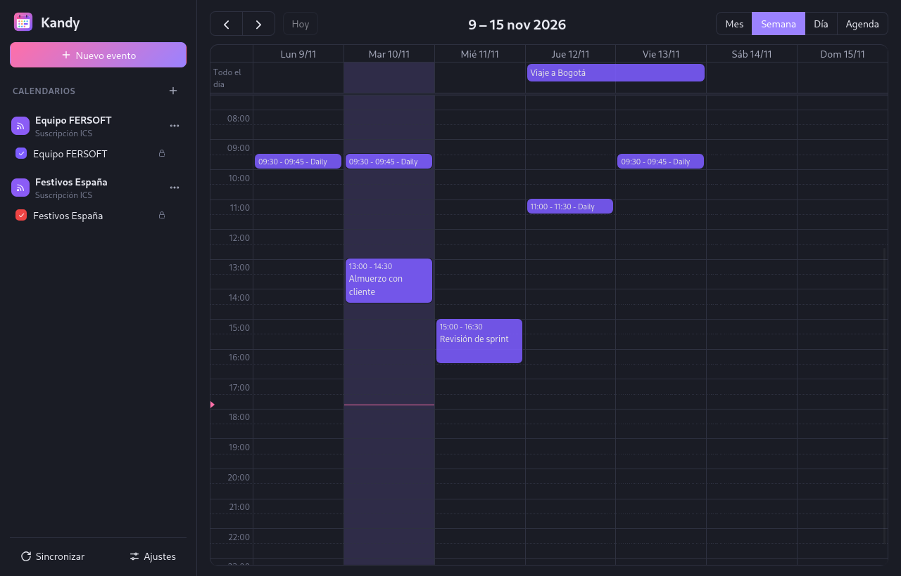
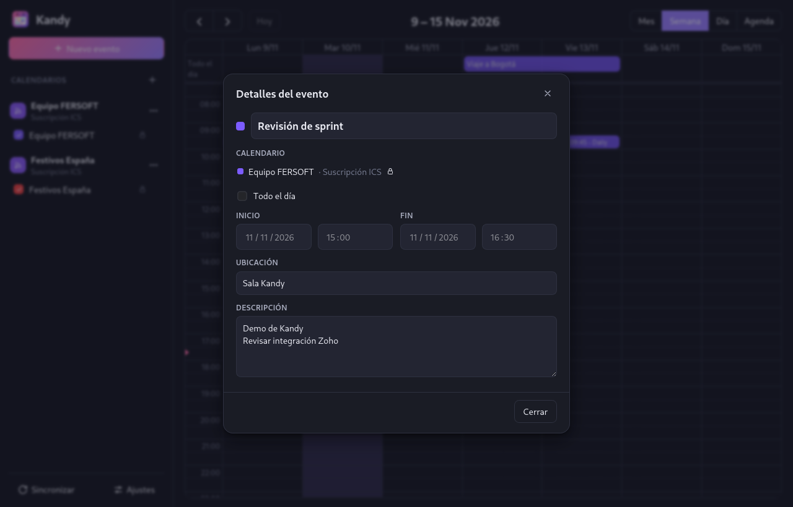
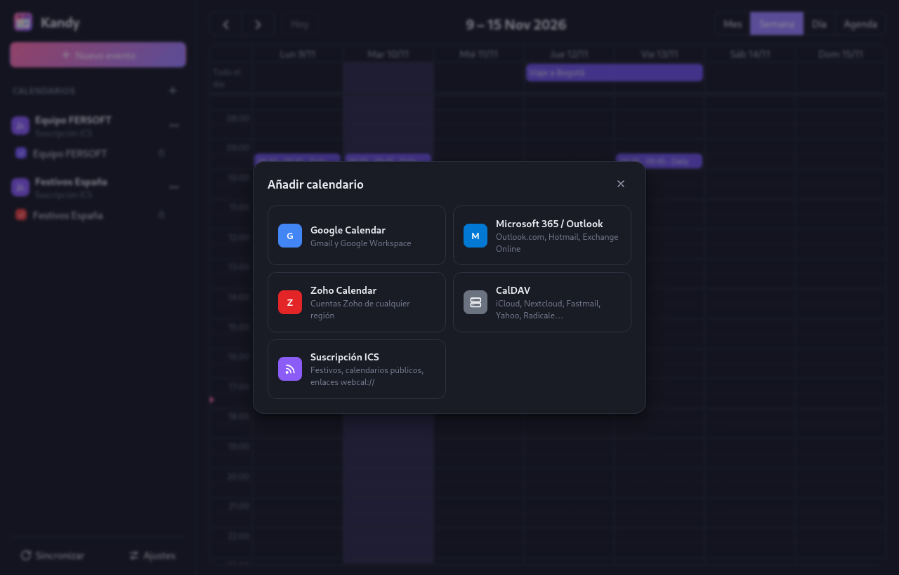

# Kandy: calendario unificado para Linux

[](https://github.com/fersot/kandy/actions/workflows/ci.yml)
[](LICENSE)

*A Linux desktop calendar (Tauri + Vue, shipped as a Flatpak) that brings Google, Microsoft 365, Zoho, CalDAV and ICS calendars together in one view.*



Kandy es un calendario de escritorio hecho con **Tauri 2 (Rust) + Vue 3 + TypeScript**, empaquetado como **Flatpak**. Reúne en una sola vista:

| Proveedor | Protocolo | Lectura | Escritura |
|---|---|---|---|
| Google Calendar | OAuth 2 + Calendar API v3 | ✅ | ✅ |
| Microsoft 365 / Outlook.com | OAuth 2 + Microsoft Graph | ✅ | ✅ |
| Zoho Calendar (todas las regiones) | OAuth 2 + Zoho Calendar API v1 | ✅ | ✅ |
| CalDAV (iCloud, Nextcloud, Fastmail, Yahoo, Radicale…) | CalDAV + contraseña de app | ✅ | ✅ (eventos no recurrentes) |
| Suscripciones ICS / webcal | HTTP | ✅ | — |

Funciones: vistas de mes, semana, día y agenda. Puedes crear, editar, arrastrar, redimensionar y borrar eventos. Kandy guarda una caché local en SQLite (funciona sin conexión), sincroniza automáticamente, avisa de los eventos próximos con notificaciones, guarda los tokens en el llavero del sistema y sigue el tema claro/oscuro del sistema.

Atajos de teclado: `n` crea un evento, `t` vuelve a hoy, `←`/`→` cambian de periodo, `m`/`w`/`d`/`a` cambian a mes, semana, día o agenda, y `Ctrl+Enter` guarda el diálogo.

## Instalación

Descarga `kandy.flatpak` de la última [Release](https://github.com/fersot/kandy/releases) y ejecuta:

```bash
flatpak install --user kandy.flatpak
flatpak run io.github.fersot.Kandy
```

Flatpak descargará de Flathub el runtime de GNOME si no lo tienes. Para conectar Google, Microsoft o Zoho, sigue [Configurar las integraciones OAuth](#configurar-las-integraciones-oauth).

| Detalle de un evento | Añadir cuentas |
|---|---|
|  |  |

---

## Arquitectura

```
┌──────────── Vue 3 (src/) ────────────┐        ┌────────────── Rust (src-tauri/src/) ──────────────┐
│ App.vue  ── FullCalendar             │ invoke │ commands.rs   comandos expuestos al frontend      │
│ Sidebar / EventDialog / Ajustes      │ ─────► │ sync.rs       sincronización + recordatorios      │
│ api.ts   (contrato tipado)           │ ◄───── │ db.rs         caché SQLite (cuentas/calend./evts) │
└──────────────────────────────────────┘ events │ secrets.rs    llavero (oo7 → portal Secret)       │
                                                │ oauth.rs      OAuth 2 + PKCE + loopback (RFC 8252)│
                                                │ ical.rs       parser iCalendar + RRULE + TZ       │
                                                │ providers/    google · microsoft · zoho ·         │
                                                │               caldav · ics                        │
                                                └───────────────────────────────────────────────────┘
```

- **La UI siempre lee de la caché local.** Al navegar se sincroniza la ventana visible ±1 mes. Además, una tarea en segundo plano refresca cada N minutos (configurable).
- **OAuth seguro para apps nativas:** Kandy usa Authorization Code + PKCE con un servidor HTTP efímero en `127.0.0.1`. El navegador se abre a través del portal `OpenURI`, así que la contraseña del usuario nunca pasa por la app.
- **Secretos:** se guardan con [`oo7`](https://github.com/bilelmoussaoui/oo7). Dentro de Flatpak usa un llavero cifrado propio con la clave del portal `org.freedesktop.portal.Secret` (GNOME Keyring o KWallet). Fuera del sandbox usa el Secret Service. Si no hay ninguno, recurre a un archivo `0600` en el directorio de datos.

---

## Desarrollo

Requisitos:
- Rust estable (vía `rustup`).
- Node.js 20 o superior.
- Las dependencias de Tauri para Linux. En Arch/CachyOS son `webkit2gtk-4.1`, `libsoup3`, `gtk3` y `librsvg`.

```bash
npm install
npm run tauri dev        # app con recarga en caliente
cd src-tauri && cargo test   # tests del parser iCal, Zoho y CalDAV
```

Los datos de desarrollo quedan en `~/.local/share/io.github.fersot.Kandy/`.

## Construir e instalar el Flatpak

```bash
./flatpak/build.sh
flatpak run io.github.fersot.Kandy
```

El script:
1. Instala (a nivel de usuario) el runtime y el SDK de GNOME 51 y las extensiones `rust-stable` y `node24`.
2. Compila **dentro del sandbox**, de modo que el binario enlaza con el WebKitGTK del runtime y no con el del sistema anfitrión.
3. Instala la app y genera `kandy.flatpak`, que se instala en otro equipo con:

```bash
flatpak install --user kandy.flatpak
```

Permisos del sandbox:

| Permiso | Para qué |
|---|---|
| `network` | APIs de los proveedores y servidor loopback de OAuth |
| `wayland`, `fallback-x11`, `dri` | Interfaz gráfica |
| `org.freedesktop.Notifications` | Recordatorios |
| `org.freedesktop.secrets` | Solo como respaldo si el portal Secret no existe |

Los datos se guardan en `~/.var/app/io.github.fersot.Kandy/`.

---

## Configurar las integraciones OAuth

Cada proveedor exige registrar una "app" una sola vez. Hay dos formas de dar las credenciales:

- **En la propia app:** Ajustes → Credenciales OAuth. Ahí se muestran también los pasos.
- **Incorporadas en el binario al compilar:** con las variables de entorno `KANDY_GOOGLE_CLIENT_ID`, `KANDY_GOOGLE_CLIENT_SECRET`, `KANDY_MICROSOFT_CLIENT_ID`, `KANDY_MICROSOFT_TENANT`, `KANDY_ZOHO_CLIENT_ID` y `KANDY_ZOHO_CLIENT_SECRET`. En el Flatpak se definen en `build-options.env` del manifiesto. Es lo adecuado para distribuir la app ya lista para tus usuarios.

> En apps de escritorio (clientes públicos) el "client secret" de Google y Zoho **no es secreto**: cualquiera puede extraerlo del binario. Ambos proveedores lo exigen igualmente y la seguridad la aporta PKCE.

### Google Calendar
1. En [Google Cloud Console](https://console.cloud.google.com/), habilita **Google Calendar API**.
2. Configura la **pantalla de consentimiento OAuth**. En modo «Prueba», añade los correos que van a usarla.
3. Ve a **Credenciales → Crear ID de cliente OAuth → App de escritorio**. No hace falta registrar una URI de redirección: Google acepta cualquier puerto de `127.0.0.1`.
4. Ámbitos que pide Kandy: `openid email profile https://www.googleapis.com/auth/calendar`.

Para publicar la app a usuarios de fuera de tu organización, Google exige verificar la app, porque el ámbito de Calendar es sensible.

### Microsoft 365 / Outlook
1. En [Microsoft Entra → Registros de aplicaciones](https://entra.microsoft.com/), crea un registro con **«Cuentas en cualquier directorio organizativo y cuentas Microsoft personales»**.
2. En **Autenticación**, añade la plataforma **Aplicaciones móviles y de escritorio** con la URI `http://localhost` y activa **Permitir flujos de clientes públicos**. Azure ignora el puerto en las URI de localhost.
3. En **Permisos de API**, añade como permisos delegados `Calendars.ReadWrite`, `User.Read` y `offline_access`.
4. El tenant `common` admite cuentas personales y de empresa.

### Zoho Calendar
1. En [Zoho API Console](https://api-console.zoho.com/), ve a **Add Client** y elige **Mobile-based Applications** (cliente público con PKCE).
2. Como URI de redirección, registra `http://localhost:8977/callback`. El puerto se cambia en Ajustes, y debe coincidir exactamente con el registrado.
3. Activa **Multi-DC** en los ajustes del cliente si hay usuarios de otras regiones (EU, IN, AU, JP, CA…). Kandy detecta la región en la redirección y usa el dominio correcto (`calendar.zoho.eu`, …).
4. Ámbitos que pide Kandy: `ZohoCalendar.calendar.ALL,ZohoCalendar.event.ALL,AaaServer.profile.READ`.

### CalDAV
No requiere registro previo. Usa la URL del servidor y una **contraseña de aplicación**:

| Servicio | URL |
|---|---|
| iCloud | `https://caldav.icloud.com/` (contraseña de app en account.apple.com) |
| Fastmail | `https://caldav.fastmail.com/` |
| Nextcloud | `https://TU-SERVIDOR/remote.php/dav/` |
| Yahoo | `https://caldav.calendar.yahoo.com/` |

Kandy descubre automáticamente los calendarios a partir del `current-user-principal`, con `/.well-known/caldav` como respaldo. También acepta la URL directa de un calendario.

---

## Limitaciones conocidas y siguientes pasos

- **Eventos recurrentes CalDAV:** se muestran todas las ocurrencias, pero para editarlos hay que usar su app original. En Google, Microsoft y Zoho sí se puede editar o borrar cada ocurrencia por separado.
- **Zoho, eventos de día completo:** la documentación no aclara si la fecha de fin es inclusiva. Kandy calcula la duración con el campo `duration` y escribe la fecha de fin como inclusiva. Conviene verificarlo con una cuenta real.
- **Recordatorios:** solo funcionan mientras la ventana está abierta. Para avisar en segundo plano haría falta un modo bandeja o autoarranque con el portal `Background`.
- No se gestionan asistentes ni invitaciones, ni se puede mover un evento de un calendario a otro.
- **Flathub:** el manifiesto actual descarga los crates y paquetes npm durante la compilación (`--share=network`). Para Flathub hay que generar fuentes offline con [flatpak-builder-tools](https://github.com/flatpak/flatpak-builder-tools):
  ```bash
  python3 flatpak-cargo-generator.py src-tauri/Cargo.lock -o flatpak/cargo-sources.json
  flatpak-node-generator npm package-lock.json -o flatpak/node-sources.json
  ```
  Después hay que añadirlas a `sources`, quitar `--share=network` de `build-args`, y compilar con `cargo --offline`. El ID `io.github.fersot.Kandy` se verifica en Flathub con la cuenta de GitHub `fersot`, y las capturas del `metainfo.xml` ya apuntan a `docs/screenshots/`.

## Estructura

```
├── src/                     Frontend Vue 3 + TS
│   ├── App.vue              FullCalendar + orquestación
│   ├── api.ts               Tipos y wrappers de invoke()
│   ├── store.ts / dates.ts  Estado global y utilidades
│   └── components/          Sidebar, EventDialog, AddAccountDialog, SettingsDialog…
├── src-tauri/
│   ├── src/                 Backend Rust (ver Arquitectura)
│   ├── tauri.conf.json      Configuración (CSP, ventana, bundle)
│   └── capabilities/        Permisos de la ventana
└── flatpak/
    ├── io.github.fersot.Kandy.yml           Manifiesto
    ├── io.github.fersot.Kandy.desktop       Lanzador
    ├── io.github.fersot.Kandy.metainfo.xml  Metadatos AppStream
    └── build.sh                             Compilar + instalar + empaquetar
```

## Publicar una versión

1. Sube el número de versión en `package.json`, `src-tauri/Cargo.toml`, `src-tauri/tauri.conf.json` y añade un `<release>` en el `metainfo.xml`.
2. Crea y sube un tag: `git tag v0.2.0 && git push origin v0.2.0`.
3. El CI compila el Flatpak y adjunta `kandy.flatpak` a la Release de GitHub.

## Contribuir

Los issues y pull requests son bienvenidos. Antes de enviar cambios, ejecuta `npm run build` y, dentro de `src-tauri/`, `cargo fmt`, `cargo clippy -- -D warnings` y `cargo test`. El CI comprueba lo mismo.

No subas credenciales OAuth al repositorio. Para compilaciones oficiales con credenciales incorporadas, usa *secrets* de GitHub Actions.

## Licencia

[MIT](LICENSE) © 2026 Hember Colmenares (FERSOFT).

Kandy no está afiliado a Google, Microsoft ni Zoho; sus nombres se usan solo para identificar los servicios con los que se integra.
